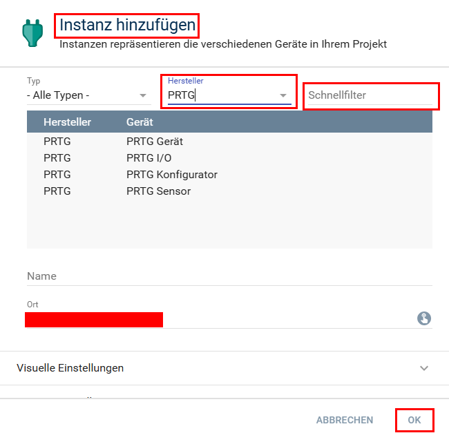
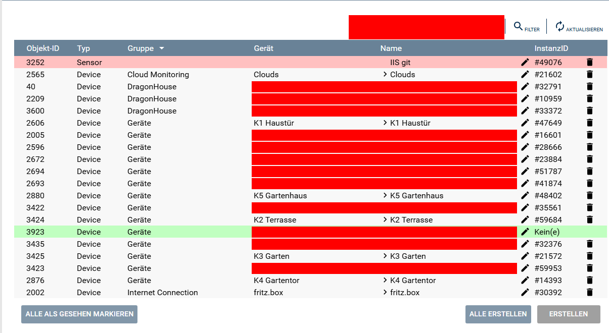
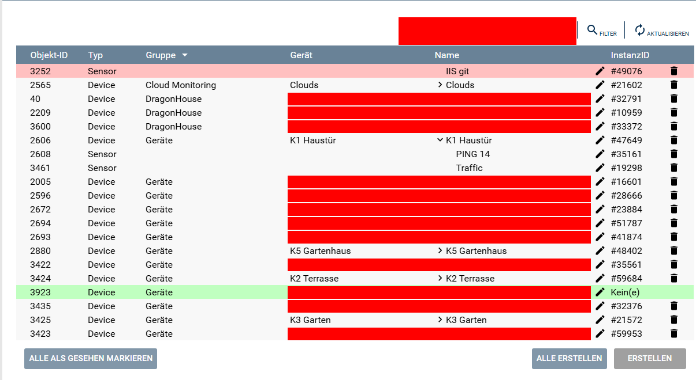

  

  
  

# PRTG Konfigurator  <!-- omit in toc -->  

Vereinfacht das Anlegen von Geräte- und Sensor-Instanzen in Symcon.  

## Inhaltsverzeichnis <!-- omit in toc -->

- [1. Funktionsumfang](#1-funktionsumfang)
- [2. Voraussetzungen](#2-voraussetzungen)
- [3. Software-Installation](#3-software-installation)
- [4. Einrichten der Instanzen in Symcon](#4-einrichten-der-instanzen-in-symcon)
- [5. Statusvariablen](#5-statusvariablen)
- [6. Visualisierung](#6-visualisierung)
- [7. PHP-Befehlsreferenz](#7-php-befehlsreferenz)
- [8. Aktionen](#8-aktionen)
- [9. Anhang](#9-anhang)
  - [1. Changelog](#1-changelog)
  - [2. Spenden](#2-spenden)
- [10. Lizenz](#10-lizenz)

## 1. Funktionsumfang

- Auflisten aller in PRTG und Symcon bekannten Geräte und Sensoren.  
- Einfaches Anlegen von Geräte- und Sensor-Instanzen in Symcon.  

## 2. Voraussetzungen

- Symcon ab Version 9.0  
- Ein aktiver [PRTG IO](../PRTGIO/README.md)  

## 3. Software-Installation

Dieses Modul ist Bestandteil der [PRTG-Library](../README.md#3-software-installation).  

## 4. Einrichten der Instanzen in Symcon

Nach der Installation aus dem Module Store erfolgt eine Abfrage, ob der Konfigurator angelegt werden soll.  
Alternativ ist das Modul im Dialog `Instanz hinzufügen` unter dem Hersteller `PRTG` zu finden.  

  

Es wird automatisch eine [PRTG IO](../PRTGIO/README.md)-Instanz erzeugt, wenn noch keine vorhanden ist.  
Erscheint im Konfigurationsformular der Hinweis `Eine übergeordnete Instanz ist inaktiv`, so ist zuerst der IO zu konfigurieren. Dieser ist über die Schaltfläche `Gateway konfigurieren` erreichbar.  
Details stehen in der [Dokumentation des IO](../PRTGIO/README.md#4-einrichten-der-instanzen-in-symcon).  

  

Ist der IO aktiv, zeigt der Konfigurator beim Öffnen oder nach Betätigen der Schaltfläche `Aktualisieren` alle Geräte und Sensoren aus PRTG an.  
Die Zusammenfassung des Konfigurators zeigt den PRTG-Server des verbundenen IO.  
Über das Auswählen eines Eintrages in der Tabelle und die Schaltfläche `Erstellen` wird die Instanz in Symcon angelegt. Alternativ können auch alle fehlenden Instanzen auf einmal erstellt werden.  

Neue Instanzen werden unterhalb einer Kategorie mit dem Namen des jeweiligen Gerätes erstellt. Diese Kategorien liegen direkt im Root des Objektbaums, es kann jedoch eine andere Ursprungskategorie ausgewählt werden.  
Die Struktur dient dem schnellen Auffinden der erstellten Instanzen. Anschließend können die Instanzen frei im Objektbaum verschoben werden.  

  

Der Konfigurator besitzt keine Eigenschaften.  

## 5. Statusvariablen

Der Konfigurator besitzt keine Statusvariablen.  

## 6. Visualisierung

Der Konfigurator besitzt keine in einer Visualisierung darstellbaren Elemente.  

## 7. PHP-Befehlsreferenz

Der Konfigurator besitzt keine Instanz-Funktionen.  

## 8. Aktionen

Es gibt keine Aktionen für den Konfigurator.  

## 9. Anhang

### 1. Changelog

[Changelog der Library](../README.md#2-changelog)  

### 2. Spenden  
  
Die Library ist für die nicht kommerzielle Nutzung kostenlos, Schenkungen als Unterstützung für den Autor werden hier akzeptiert:  

  

  

## 10. Lizenz

Symcon-Modul:  
[Custom NC-SA](../LICENSE)  
