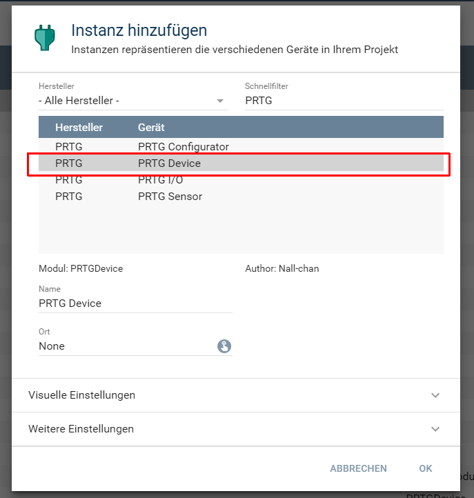
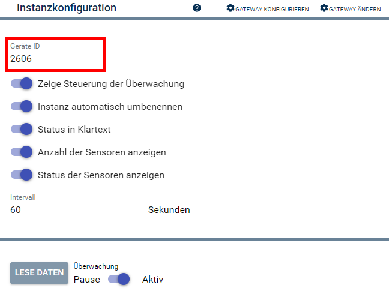
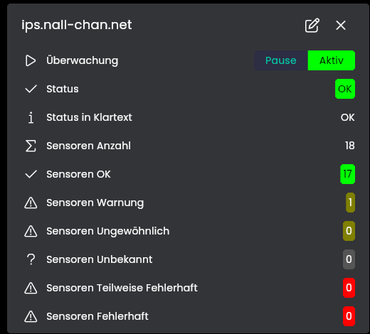
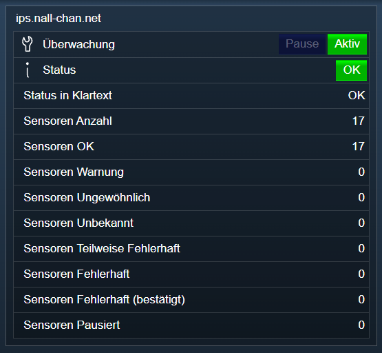
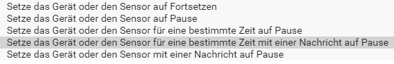

[](https://www.symcon.de/service/dokumentation/entwicklerbereich/sdk-tools/sdk-php/)
[](https://community.symcon.de/t/modul-prtg-prtg-in-ips-einbinden-und-ips-in-prtg-ueberwachen/47105)
[](https://www.symcon.de/de/service/dokumentation/installation/migrationen/v80-v81-q3-2025/)  
[](#10-lizenz)
[](https://github.com/Nall-chan/PRTG/actions)
[](https://github.com/Nall-chan/PRTG/actions)  
[](#2-spenden)[](#2-spenden)  

# PRTG Gerät  <!-- omit in toc -->

Einbindung eines Gerätes aus PRTG in Symcon.  

## Inhaltsverzeichnis <!-- omit in toc -->

- [1. Funktionsumfang](#1-funktionsumfang)
- [2. Voraussetzungen](#2-voraussetzungen)
- [3. Software-Installation](#3-software-installation)
- [4. Einrichten der Instanzen in Symcon](#4-einrichten-der-instanzen-in-symcon)
- [5. Statusvariablen](#5-statusvariablen)
- [6. Visualisierung](#6-visualisierung)
  - [Kachel Visualisierung](#kachel-visualisierung)
  - [WebFront Visualisierung](#webfront-visualisierung)
- [7. PHP-Befehlsreferenz](#7-php-befehlsreferenz)
- [8. Aktionen](#8-aktionen)
- [9. Anhang](#9-anhang)
  - [1. Changelog](#1-changelog)
  - [2. Spenden](#2-spenden)
- [10. Lizenz](#10-lizenz)

## 1. Funktionsumfang

- Darstellen des Zustands eines Gerätes aus PRTG.  
- Darstellen der Anzahl der Sensoren des Gerätes je Zustand.  
- Pausieren und Fortsetzen der Überwachung über die Visualisierung, Aktionen und PHP-Skripte.  

## 2. Voraussetzungen

- Symcon ab Version 8.2  
- Ein aktiver [PRTG IO](../PRTGIO/README.md)  

## 3. Software-Installation

Dieses Modul ist Bestandteil der [PRTG-Library](../README.md#3-software-installation).  

## 4. Einrichten der Instanzen in Symcon

Das Anlegen von neuen Instanzen erfolgt am einfachsten über den [PRTG Konfigurator](../PRTGConfigurator/README.md#4-einrichten-der-instanzen-in-symcon).  
Alternativ ist das Modul im Dialog `Instanz hinzufügen` unter dem Hersteller `PRTG` zu finden.  

  

Es wird automatisch eine [PRTG IO](../PRTGIO/README.md)-Instanz erzeugt, wenn noch keine vorhanden ist.  
Erscheint im Konfigurationsformular der Hinweis `Eine übergeordnete Instanz ist inaktiv`, so ist zuerst der IO zu konfigurieren. Dieser ist über die Schaltfläche `Gateway konfigurieren` erreichbar.  
Details stehen in der [Dokumentation des IO](../PRTGIO/README.md#4-einrichten-der-instanzen-in-symcon).  

  

**Konfigurationsseite:**  

| Eigenschaft                     | Name                |   Typ   | Standardwert | Beschreibung                                                                         |
| :------------------------------ | :------------------ | :-----: | :----------: | :----------------------------------------------------------------------------------- |
| Geräte ID                       | id                  | integer |      0       | Objekt-ID des Gerätes in PRTG (in PRTG in der URL der Geräteseite: `device.htm?id=`) |
| Zeige Steuerung der Überwachung | ShowActionButton    |  bool   |     true     | Statusvariable `Überwachung` zum Pausieren und Fortsetzen anlegen                    |
| Instanz automatisch umbenennen  | AutoRename          |  bool   |    false     | Name der Instanz an den Namen des Gerätes in PRTG anpassen                           |
| Status in Klartext              | ReadableState       |  bool   |     true     | Statusvariable `Status in Klartext` anlegen                                          |
| Anzahl der Sensoren anzeigen    | DisplayTotalSensors |  bool   |     true     | Statusvariable `Sensoren Anzahl` anlegen                                             |
| Status der Sensoren anzeigen    | DisplaySensorState  |  bool   |     true     | Statusvariablen mit der Anzahl der Sensoren je Zustand anlegen                       |
| Intervall                       | Interval            | integer |      60      | Abfrageintervall in Sekunden (mindestens 5)                                          |

Wird eine der Eigenschaften `Zeige Steuerung der Überwachung`, `Status in Klartext`, `Anzahl der Sensoren anzeigen` oder `Status der Sensoren anzeigen` deaktiviert, so werden die zugehörigen Statusvariablen gelöscht.  

Die Zusammenfassung der Instanz zeigt die Gruppe des Gerätes in PRTG.  
Existiert das Objekt in PRTG nicht (mehr), zeigt die Instanz den Status `Objekt in PRTG nicht gefunden` und meldet dies einmalig im Log.  

Beispiel zum Setzen der Eigenschaften per Skript:  

```php
IPS_SetProperty(12345, 'id', 2001);
IPS_SetProperty(12345, 'Interval', 120);
IPS_ApplyChanges(12345);
```

## 5. Statusvariablen

| Name                            |   Typ   | Ident           | Beschreibung                                                     |
| :------------------------------ | :-----: | :-------------- | :--------------------------------------------------------------- |
| Status                          | integer | State           | Zustand des Gerätes (Werte siehe unten)                          |
| Status in Klartext              | string  | ReadableState   | Zustand des Gerätes als Text, wie er von PRTG übertragen wird    |
| Überwachung                     |  bool   | ActionButton    | `true` = Überwachung aktiv, `false` = pausiert; bedienbar        |
| Sensoren Anzahl                 | integer | TotalSens       | Anzahl aller Sensoren des Gerätes                                |
| Sensoren OK                     | integer | UpSens          | Anzahl der Sensoren im Zustand OK                                |
| Sensoren Warnung                | integer | WarnSens        | Anzahl der Sensoren im Zustand Warnung                           |
| Sensoren Ungewöhnlich           | integer | UnusualSens     | Anzahl der Sensoren im Zustand Ungewöhnliche Daten               |
| Sensoren Unbekannt              | integer | UndefinedSens   | Anzahl der Sensoren im Zustand Unbekannt                         |
| Sensoren Teilweise Fehlerhaft   | integer | PartialDownSens | Anzahl der Sensoren im Zustand Fehler (Teilweise)                |
| Sensoren Fehlerhaft             | integer | DownSens        | Anzahl der Sensoren im Zustand Fehler                            |
| Sensoren Fehlerhaft (bestätigt) | integer | DownAckSens     | Anzahl der Sensoren im Zustand Fehler (Bestätigt)                |
| Sensoren Pausiert               | integer | PausedSens      | Anzahl der pausierten Sensoren                                   |

Werte der Variable `Status`:  

| Wert | Zustand   | Wert | Zustand                     |
| :--: | :-------- | :--: | :-------------------------- |
|  1   | Unbekannt |  8   | Pausiert durch Abhängigkeit |
|  2   | Suche     |  9   | Pausiert über Zeitplan      |
|  3   | OK        |  10  | Ungewöhnliche Daten         |
|  4   | Warnung   |  11  | Nicht lizenziert            |
|  5   | Fehler    |  12  | Pausiert über Zeitraum      |
|  6   | Kein Test |  13  | Fehler (Bestätigt)          |
|  7   | Pausiert  |  14  | Fehler (Teilweise)          |

## 6. Visualisierung

Die Darstellung und Steuerung ist in der Kachel Visualisierung und im WebFront möglich.  

### Kachel Visualisierung

  

### WebFront Visualisierung

  

Einige Symbole sind Font-Awesome-Symbole (z.B. bei `Status` und `Überwachung`). Diese zeigt das klassische WebFront nicht an.  

## 7. PHP-Befehlsreferenz

Nach erfolgreichem Pausieren, Fortsetzen setzt die Instanz die Statusvariablen sofort (z.B. `Pausiert`, nach dem Fortsetzen `Suche`), weil PRTG den neuen Zustand erst verzögert meldet. Beim Fortsetzen stößt sie in PRTG einen sofortigen Scan an. Den tatsächlichen Zustand liefert die nächste Abfrage.  
Schlägt ein Befehl fehl, gibt er `false` zurück und meldet den Grund (z.B. `PRTG nicht erreichbar`, `Objekt in PRTG nicht gefunden`).  

```php
bool PRTG_RequestState(integer $InstanzID);
```

Liest den Zustand des Gerätes aus PRTG und aktualisiert die Statusvariablen.  
Gibt `true` zurück, wenn der Zustand gelesen wurde, sonst `false`.  

```php
PRTG_RequestState(12345);
```

---

```php
bool PRTG_SetResume(integer $InstanzID);
```

Setzt die Überwachung des Gerätes in PRTG fort.  
Gibt `true` zurück, wenn PRTG den Befehl angenommen hat, sonst `false`.  

```php
PRTG_SetResume(12345);
```

---

```php
bool PRTG_SetPause(integer $InstanzID);
```

Pausiert die Überwachung des Gerätes in PRTG ohne zeitliche Begrenzung.  
Gibt `true` zurück, wenn PRTG den Befehl angenommen hat, sonst `false`.  

```php
PRTG_SetPause(12345);
```

---

```php
bool PRTG_SetPauseEx(integer $InstanzID, string $Message);
```

Pausiert die Überwachung des Gerätes in PRTG ohne zeitliche Begrenzung.  
`$Message` ist der Text, den PRTG als Grund der Pause anzeigt. Ein leerer String pausiert ohne Meldung.  
Gibt `true` zurück, wenn PRTG den Befehl angenommen hat, sonst `false`.  

```php
PRTG_SetPauseEx(12345, 'Wartung');
```

---

```php
bool PRTG_SetPauseDuration(integer $InstanzID, integer $Minutes);
```

Pausiert die Überwachung des Gerätes in PRTG für `$Minutes` Minuten. Danach setzt PRTG die Überwachung selbst fort.  
Bei `0` wird ohne zeitliche Begrenzung pausiert, negative Werte werden abgelehnt.  
Gibt `true` zurück, wenn PRTG den Befehl angenommen hat, sonst `false`.  

```php
PRTG_SetPauseDuration(12345, 60);
```

---

```php
bool PRTG_SetPauseDurationEx(integer $InstanzID, integer $Minutes, string $Message);
```

Wie `PRTG_SetPauseDuration`, zusätzlich mit dem Text `$Message`, den PRTG als Grund der Pause anzeigt.  

```php
PRTG_SetPauseDurationEx(12345, 60, 'Wartung');
```

## 8. Aktionen

**Grundsätzlich können alle bedienbaren Statusvariablen als Ziel einer [`Aktion`](https://www.symcon.de/service/dokumentation/konzepte/automationen/ablaufplaene/aktionen/) mit `Auf Wert schalten` angesteuert werden, so dass hier keine speziellen Aktionen benutzt werden müssen.**

Wird eine `PRTG Gerät`-Instanz als Ziel einer Aktion ausgewählt, stehen zusätzlich folgende Aktionen zur Verfügung:  

- Setze das Gerät oder den Sensor auf Pause  
- Setze das Gerät oder den Sensor mit einer Nachricht auf Pause  
- Setze das Gerät oder den Sensor für eine bestimmte Zeit auf Pause  
- Setze das Gerät oder den Sensor für eine bestimmte Zeit mit einer Nachricht auf Pause  
- Setze das Gerät oder den Sensor auf Fortsetzen  

  

## 9. Anhang

### 1. Changelog

[Changelog der Library](../README.md#2-changelog)  

### 2. Spenden  
  
Die Library ist für die nicht kommerzielle Nutzung kostenlos, Schenkungen als Unterstützung für den Autor werden hier akzeptiert:  

[](https://paypal.me/Nall4chan)  

[](https://www.amazon.de/hz/wishlist/ls/YU4AI9AQT9F?ref_=wl_share)  

## 10. Lizenz

Symcon-Modul:  
[Custom NC-SA](../LICENSE)  
