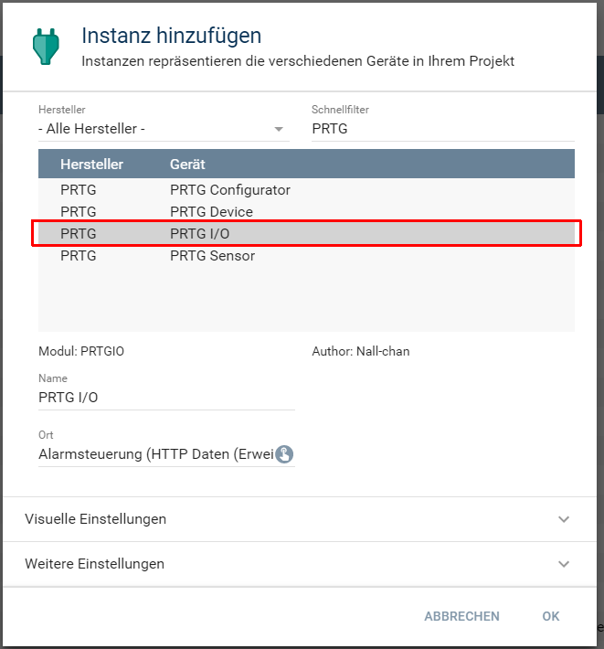
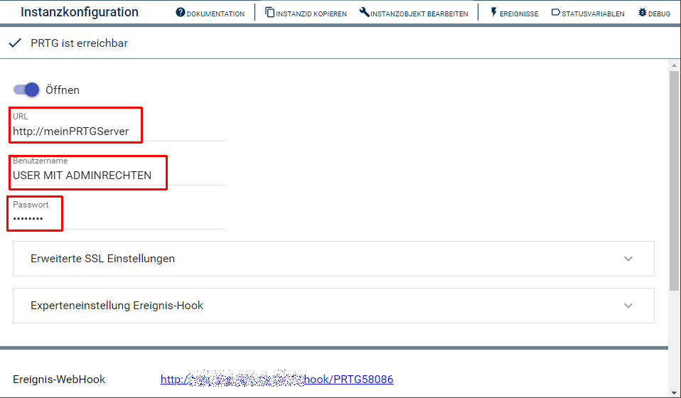
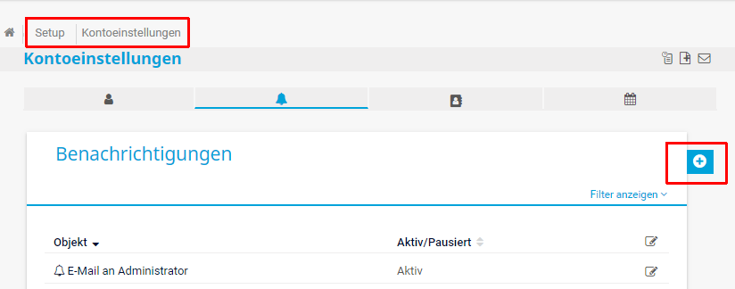
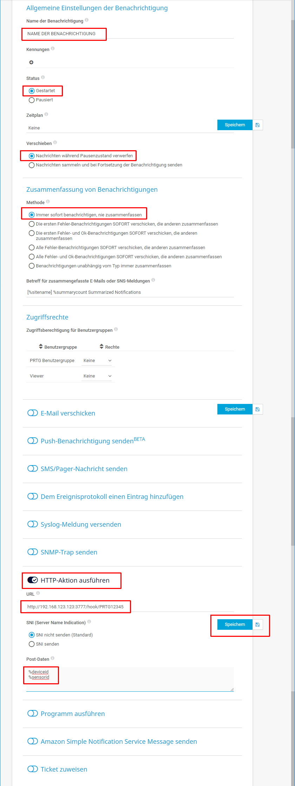
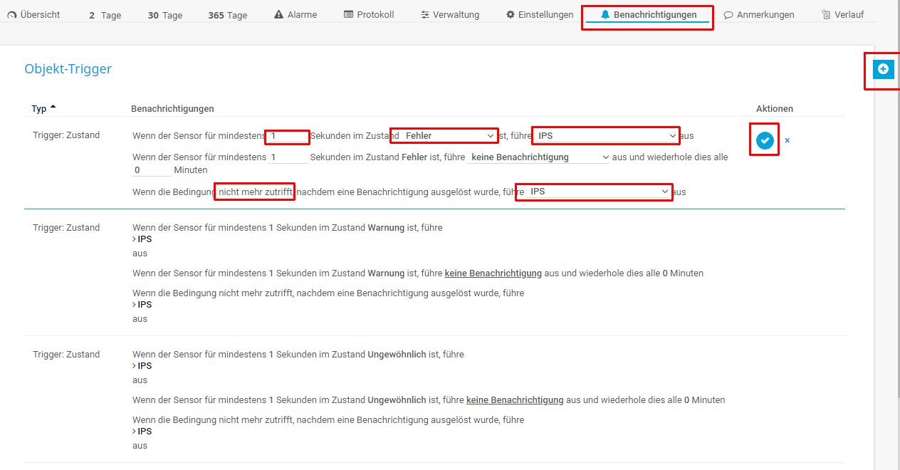
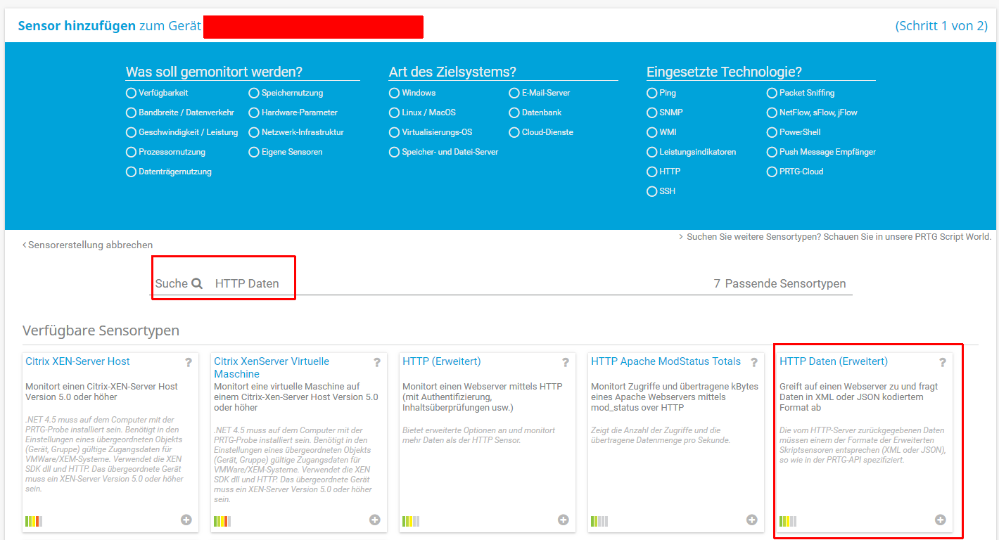
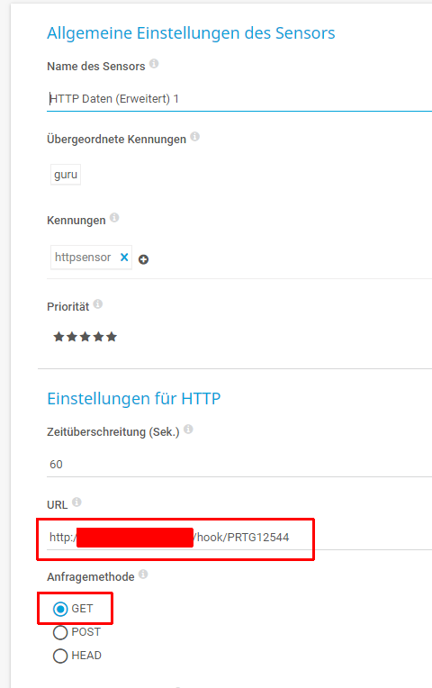
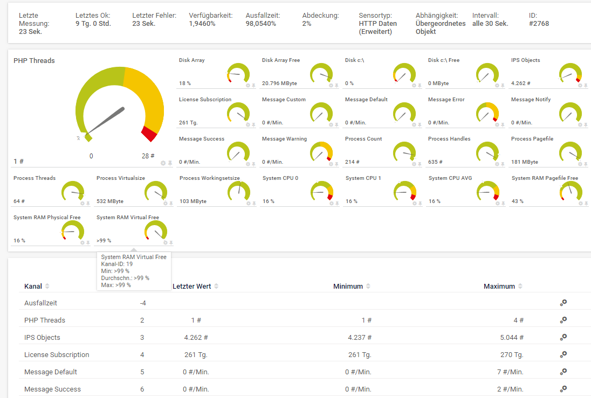

[](https://www.symcon.de/service/dokumentation/entwicklerbereich/sdk-tools/sdk-php/)
[](https://community.symcon.de/t/modul-prtg-prtg-in-ips-einbinden-und-ips-in-prtg-ueberwachen/47105)
[](https://www.symcon.de/de/service/dokumentation/installation/migrationen/v80-v81-q3-2025/)  
[](#10-lizenz)
[](https://github.com/Nall-chan/PRTG/actions)
[](https://github.com/Nall-chan/PRTG/actions)  
[](#2-spenden)[](#2-spenden)  

# PRTG IO  <!-- omit in toc -->

I/O zur Kommunikation mit PRTG.  

## Inhaltsverzeichnis <!-- omit in toc -->

- [1. Funktionsumfang](#1-funktionsumfang)
- [2. Voraussetzungen](#2-voraussetzungen)
- [3. Software-Installation](#3-software-installation)
- [4. Einrichten der Instanzen in Symcon](#4-einrichten-der-instanzen-in-symcon)
  - [Ereignisse von PRTG empfangen](#ereignisse-von-prtg-empfangen)
  - [Symcon in PRTG überwachen](#symcon-in-prtg-überwachen)
  - [Graphen über den WebHook abrufen](#graphen-über-den-webhook-abrufen)
- [5. Statusvariablen](#5-statusvariablen)
- [6. Visualisierung](#6-visualisierung)
- [7. PHP-Befehlsreferenz](#7-php-befehlsreferenz)
- [8. Aktionen](#8-aktionen)
- [9. Anhang](#9-anhang)
  - [1. Changelog](#1-changelog)
  - [2. Spenden](#2-spenden)
- [10. Lizenz](#10-lizenz)

## 1. Funktionsumfang

- Schnittstelle zwischen den Geräte- und Sensor-Instanzen und PRTG.  
- Empfangen von Ereignissen aus PRTG über einen WebHook.  
- Bereitstellen von Systeminformationen aus Symcon für einen Sensor in PRTG.  
- Abrufen von Graphen aus PRTG.  

## 2. Voraussetzungen

- Symcon ab Version 8.2  
- PRTG mit erreichbarer Weboberfläche  
- Ein Benutzer in PRTG, der die Überwachung steuern und Alarme bestätigen darf (administrative Rechte)  

## 3. Software-Installation

Dieses Modul ist Bestandteil der [PRTG-Library](../README.md#3-software-installation).  

## 4. Einrichten der Instanzen in Symcon

Die Instanz wird automatisch erzeugt, sobald z.B. der [PRTG Konfigurator](../PRTGConfigurator/README.md) erstellt wird.  
Alternativ ist das Modul im Dialog `Instanz hinzufügen` unter dem Hersteller `PRTG` zu finden.  

  

Die erweiterten SSL-Einstellungen sind ab Werk inaktiv. Für selbst signierte Zertifikate sind z.B. `Deaktiviere Prüfung des Hostnamen` und `Deaktiviere Prüfung der Gegenstelle` zu aktivieren.  

Die Adresse des Ereignis-WebHooks für PRTG wird unterhalb der Konfiguration angezeigt.  
Dabei werden sowohl mehrere IP-Adressen als auch die globalen NAT-Einstellungen von Symcon beachtet.  
Ist es aus anderen Gründen nötig, die Adresse anzupassen, so kann dies im Bereich `Experteneinstellung Ereignis-Hook` erfolgen.  

  

**Konfigurationsseite:**  

| Eigenschaft                          | Name           |   Typ   | Standardwert | Beschreibung                                                                  |
| :----------------------------------- | :------------- | :-----: | :----------: | :---------------------------------------------------------------------------- |
| Öffnen                               | Open           |  bool   |    false     | Verbindung zu PRTG herstellen                                                 |
| URL                                  | Host           | string  |   http://    | URL der PRTG-Weboberfläche, z.B. `https://prtg.local:8443`                    |
| Benutzername                         | Username       | string  |              | Benutzername in PRTG                                                          |
| Passwort                             | Password       | string  |              | Passwort des Benutzers                                                        |
| Deaktiviere Prüfung des Hostnamen    | NoHostVerify   |  bool   |    false     | Hostname im Zertifikat nicht prüfen                                           |
| Deaktiviere Prüfung der Gegenstelle  | NoPeerVerify   |  bool   |    false     | Zertifikat der Gegenstelle nicht prüfen (z.B. selbst signiert)                |
| Deaktiviere Prüfung des Zertifikat   | NoCertCheck    |  bool   |    false     | Status des Zertifikats nicht prüfen                                           |
| IP für Ereignis-Hook                 | ReturnIP       | string  |              | Abweichende IP-Adresse oder Hostname von Symcon für den Ereignis-WebHook      |
| Port für Ereignis-Hook               | ReturnPort     | integer |     3777     | Abweichender Port von Symcon für den Ereignis-WebHook                         |
| https benutzen                       | ReturnProtocol |  bool   |    false     | `true` = Ereignis-WebHook mit https, `false` = mit http                       |

Beispiel zum Setzen der Eigenschaften per Skript:  

```php
IPS_SetProperty(12345, 'Host', 'https://prtg.local:8443');
IPS_SetProperty(12345, 'Username', 'symcon');
IPS_SetProperty(12345, 'Password', 'geheim');
IPS_SetProperty(12345, 'Open', true);
IPS_ApplyChanges(12345);
```

Über den WebHook `/hook/PRTG<InstanzID>` empfängt die Instanz Ereignisse von PRTG und liefert Systeminformationen sowie Graphen.  

> [!IMPORTANT]
> Der WebHook ist ohne Anmeldung erreichbar. Er liefert Systeminformationen von Symcon und Graphen aus PRTG mit den in der Instanz hinterlegten Zugangsdaten. Den WebHook daher nicht ungeschützt aus dem Internet erreichbar machen.

### Ereignisse von PRTG empfangen

PRTG kann bei Statusänderungen eines Sensors eine Benachrichtigung an Symcon senden. Symcon stellt den Zustand dann zeitnah dar und nicht erst mit der nächsten Abfrage.  

  

Hierzu muss zuerst in PRTG eine neue Benachrichtigung mit folgenden Parametern angelegt werden:  

- Name: beliebig, z.B. `Symcon`  
- Status: gestartet  
- Verschieben: Nachrichten während Pausenzustand verwerfen  
- Methode: Immer sofort benachrichtigen, nie zusammenfassen  
- HTTP-Aktion ausführen: URL des WebHooks nach folgendem Schema eintragen:  

```text
http://<Symcon-IP>:<Symcon-Port>/hook/PRTG<InstanzID>
```

z.B. `http://192.168.123.123:3777/hook/PRTG12345`  
Die URL wird in der Konfiguration der Instanz angezeigt.  

- Post-Daten:  

```text
%deviceid
%sensorid
```

  

Anschließend müssen noch Trigger definiert werden, welche diese Benachrichtigung auslösen.  
PRTG vererbt Konfigurationen vom obersten Element nach unten. Somit können einzelne Objekte diese Benachrichtigung auslösen oder auch alle.  
Soll die Benachrichtigung für alle Sensoren erfolgen, so werden die Trigger im Objekt 0 (oberstes Element im Gerätebaum von PRTG) unter Benachrichtigungen angelegt.  

Hier sind vier Trigger für die Zustände `Fehler`, `Warnung`, `Ungewöhnlich` und `Fehler (teilweise)` anzulegen.  
Als Aktion wird immer die oben erzeugte Benachrichtigung ausgewählt, auch für den Fall, dass die Bedingung nicht mehr zutrifft.  
Empfängt Symcon eine Benachrichtigung, so wird dies im Reiter Debug der Instanz mit `PRTG EVENT` ausgegeben.  

  

### Symcon in PRTG überwachen

Die Instanz stellt Daten für einen HTTP-Sensor in PRTG bereit. Dieser wird wie folgt in PRTG eingebunden:  

- Unterhalb des gewünschten Gerätes einen neuen Sensor hinzufügen.  
- Im Suchfeld `HTTP Daten` eingeben und den Sensor `HTTP Daten (Erweitert)` auswählen.  
- Als URL wird wieder der WebHook eingetragen, z.B. `http://192.168.123.123:3777/hook/PRTG12345`.  
- Die Anfragemethode bleibt auf `GET`.  

Nach dem Speichern der Sensoreinstellungen dauert es einen Augenblick, bis PRTG die ersten Werte darstellt.  

  
  
  

Der Sensor liefert folgende Kanäle, die Grenzwerte für Warnung und Fehler sind bereits vorbelegt:  

| Kanal                                                           | Inhalt                                                                         |
| :-------------------------------------------------------------- | :----------------------------------------------------------------------------- |
| PHP Threads                                                     | Anzahl der gerade belegten PHP-Threads                                         |
| PHP Threads duration (avg)                                      | Durchschnittliche Laufzeit der PHP-Threads in ms                               |
| PHP Threads memory usage (avg)                                  | Durchschnittlicher Speicherverbrauch der PHP-Threads                           |
| IPS Objects                                                     | Anzahl der Objekte im Objektbaum                                               |
| License Subscription                                            | Restlaufzeit des Subskriptionszeitraums (nur wenn vorhanden)                   |
| Message …                                                       | Log-Meldungen je Typ pro Minute (seit dem letzten Zurücksetzen der Statistik)  |
| Message Slow, Message Slow Counter                              | Langsame Nachrichten pro Minute bzw. gesamt seit dem Start von Symcon          |
| Message Queue Size                                              | Größe der Nachrichtenwarteschlange                                             |
| Process Handles, Threads, Virtualsize, Workingsetsize, Pagefile | Daten des Symcon-Prozesses                                                     |
| Process Count                                                   | Anzahl der Prozesse des Systems                                                |
| System RAM Physical/Pagefile/Virtual Free                       | Freier Arbeitsspeicher in Prozent                                              |
| System CPU …                                                    | Auslastung je CPU in Prozent                                                   |
| Disk …, Disk … Free                                             | Freier Speicherplatz je Laufwerk in Prozent bzw. Byte                          |

### Graphen über den WebHook abrufen

Graphen aus PRTG können direkt über den WebHook abgerufen werden, z.B. für eine HTML-Box oder einen Browser:  

```text
http://<Symcon-IP>:<Symcon-Port>/hook/PRTG<InstanzID>?graph=png&id=<SensorID>
```

| Parameter    | Pflicht | Standard | Beschreibung                                                     |
| :----------- | :-----: | :------: | :--------------------------------------------------------------- |
| graph        |   ja    |          | `png` oder `svg`                                                 |
| id           |   ja    |          | Objekt-ID des Sensors in PRTG                                    |
| graphid      |  nein   |    0     | Zeitbereich: 0 = live, 1 = 48 Stunden, 2 = 30 Tage, 3 = 365 Tage |
| width        |  nein   |   800    | Breite in Pixel                                                  |
| height       |  nein   |   400    | Höhe in Pixel                                                    |
| theme        |  nein   |    0     | Darstellungsschema von PRTG (0 bis 3)                            |
| basefontsize |  nein   |    10    | Schriftgröße                                                     |
| showlegend   |  nein   |    1     | 1 = Legende anzeigen, 0 = ausblenden                             |

Sind die Parameter ungültig oder ist PRTG nicht erreichbar, antwortet der WebHook mit `400 Bad Request` und einem Fehlertext.  

## 5. Statusvariablen

Der IO besitzt keine Statusvariablen.  

## 6. Visualisierung

Der IO besitzt keine in einer Visualisierung darstellbaren Elemente.  

## 7. PHP-Befehlsreferenz

```php
string PRTG_GetGraph(integer $InstanzID, integer $Type, integer $SensorId, integer $GraphId, integer $Width, integer $Height, integer $Theme, integer $BaseFontSize, bool $ShowLegend);
```

Liefert ein PNG- oder SVG-Bild eines Graphen aus PRTG als String.  
Sind die Parameter ungültig, ist PRTG nicht erreichbar oder konnte der Graph nicht geladen werden, wird eine Fehlermeldung ausgegeben und `false` zurückgegeben.  

- `$Type`: `1` = PNG, `2` = SVG  
- `$SensorId`: Objekt-ID des Sensors in PRTG. Sie steht in PRTG in der URL der Sensorseite (`sensor.htm?id=<SensorId>`) und in der Konfiguration der [PRTG Sensor](../PRTGSensor/README.md)-Instanz.  
- `$GraphId`: Zeitbereich des Graphen: `0` = live, `1` = 48 Stunden, `2` = 30 Tage, `3` = 365 Tage  
- `$Width`: Breite des Graphen in Pixel  
- `$Height`: Höhe des Graphen in Pixel  
- `$Theme`: Darstellungsschema von PRTG (`0` bis `3`)  
- `$BaseFontSize`: Schriftgröße, `10` ist Standard  
- `$ShowLegend`: `true` = Legende anzeigen, `false` = ausblenden  

Der Rückgabewert einer Instanz-Funktion ist auf 1 MB begrenzt. Für große Graphen den [WebHook](#graphen-über-den-webhook-abrufen) verwenden.  

```php
$Svg = PRTG_GetGraph(12345, 2, 2001, 800, 400, 0, 10, true);
SetValueString(23456, $Svg);
```

## 8. Aktionen

Es gibt keine Aktionen für den IO.  

## 9. Anhang

### 1. Changelog

[Changelog der Library](../README.md#2-changelog)  

### 2. Spenden  
  
Die Library ist für die nicht kommerzielle Nutzung kostenlos, Schenkungen als Unterstützung für den Autor werden hier akzeptiert:  

[](https://paypal.me/Nall4chan)  

[](https://www.amazon.de/hz/wishlist/ls/YU4AI9AQT9F?ref_=wl_share)  

## 10. Lizenz

Symcon-Modul:  
[Custom NC-SA](../LICENSE)  
