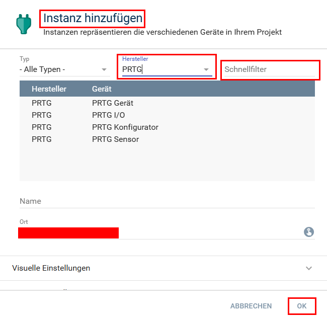
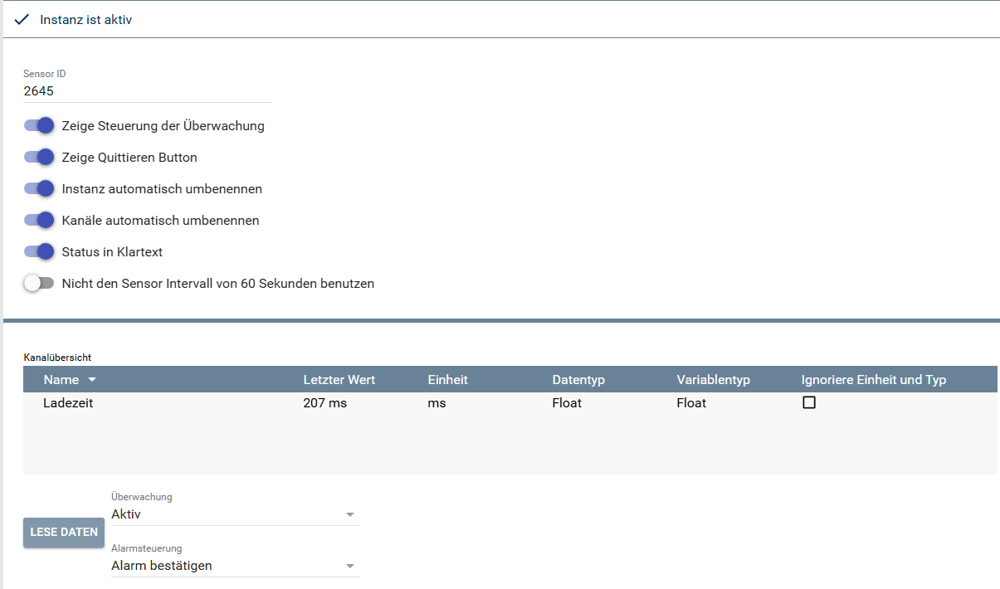
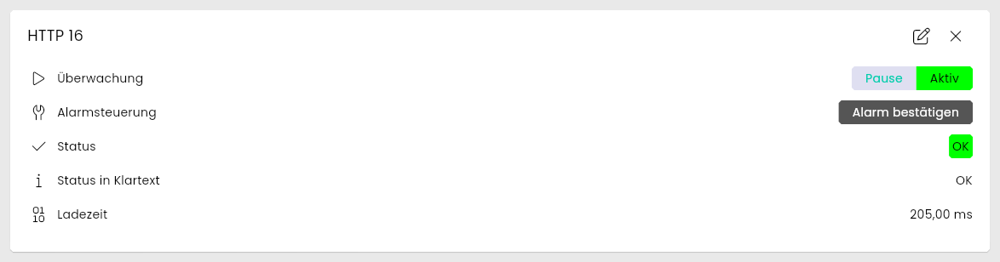
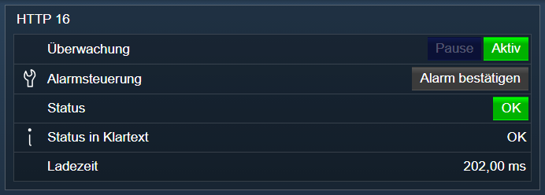
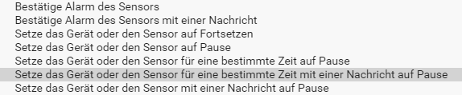

[](https://www.symcon.de/service/dokumentation/entwicklerbereich/sdk-tools/sdk-php/)
[](https://community.symcon.de/t/modul-prtg-prtg-in-ips-einbinden-und-ips-in-prtg-ueberwachen/47105)
[](https://www.symcon.de/de/service/dokumentation/installation/migrationen/v80-v81-q3-2025/)  
[](#10-lizenz)
[](https://github.com/Nall-chan/PRTG/actions)
[](https://github.com/Nall-chan/PRTG/actions)  
[](#2-spenden)[](#2-spenden)  

# PRTG Sensor  <!-- omit in toc -->

Einbindung eines Sensors aus PRTG in Symcon.  

## Inhaltsverzeichnis <!-- omit in toc -->

- [1. Funktionsumfang](#1-funktionsumfang)
- [2. Voraussetzungen](#2-voraussetzungen)
- [3. Software-Installation](#3-software-installation)
- [4. Einrichten der Instanzen in Symcon](#4-einrichten-der-instanzen-in-symcon)
  - [Kanalübersicht](#kanalübersicht)
- [5. Statusvariablen](#5-statusvariablen)
  - [Variablen der Kanäle](#variablen-der-kanäle)
- [6. Visualisierung](#6-visualisierung)
  - [Kachel Visualisierung](#kachel-visualisierung)
  - [WebFront Visualisierung](#webfront-visualisierung)
- [7. PHP-Befehlsreferenz](#7-php-befehlsreferenz)
- [8. Aktionen](#8-aktionen)
- [9. Anhang](#9-anhang)
  - [1. Changelog](#1-changelog)
  - [2. Spenden](#2-spenden)
- [10. Lizenz](#10-lizenz)

## 1. Funktionsumfang

- Darstellen des Zustands eines Sensors aus PRTG.  
- Darstellen der Werte aller Kanäle des Sensors in eigenen Statusvariablen.  
- Pausieren und Fortsetzen der Überwachung über die Visualisierung, Aktionen und PHP-Skripte.  
- Bestätigen von Alarmen über die Visualisierung, Aktionen und PHP-Skripte.  

## 2. Voraussetzungen

- Symcon ab Version 9.0  
- Ein aktiver [PRTG IO](../PRTGIO/README.md)  

## 3. Software-Installation

Dieses Modul ist Bestandteil der [PRTG-Library](../README.md#3-software-installation).  

## 4. Einrichten der Instanzen in Symcon

Das Anlegen von neuen Instanzen erfolgt am einfachsten über den [PRTG Konfigurator](../PRTGConfigurator/README.md#4-einrichten-der-instanzen-in-symcon).  
Alternativ ist das Modul im Dialog `Instanz hinzufügen` unter dem Hersteller `PRTG` zu finden.  

  

Es wird automatisch eine [PRTG IO](../PRTGIO/README.md)-Instanz erzeugt, wenn noch keine vorhanden ist.  
Erscheint im Konfigurationsformular der Hinweis `Eine übergeordnete Instanz ist inaktiv`, so ist zuerst der IO zu konfigurieren. Dieser ist über die Schaltfläche `Gateway konfigurieren` erreichbar.  
Details stehen in der [Dokumentation des IO](../PRTGIO/README.md#4-einrichten-der-instanzen-in-symcon).  

  

**Konfigurationsseite:**  

| Eigenschaft                                         | Name               |   Typ   | Standardwert | Beschreibung                                                                         |
| :-------------------------------------------------- | :----------------- | :-----: | :----------: | :----------------------------------------------------------------------------------- |
| Sensor ID                                           | id                 | integer |      0       | Objekt-ID des Sensors in PRTG (in PRTG in der URL der Sensorseite: `sensor.htm?id=`) |
| Zeige Steuerung der Überwachung                     | ShowActionButton   |  bool   |     true     | Statusvariable `Überwachung` zum Pausieren und Fortsetzen anlegen                    |
| Zeige Quittieren Button                             | ShowAckButton      |  bool   |     true     | Statusvariable `Alarmsteuerung` zum Bestätigen eines Alarms anlegen                  |
| Instanz automatisch umbenennen                      | AutoRename         |  bool   |    false     | Name der Instanz an den Namen des Sensors in PRTG anpassen                           |
| Kanäle automatisch umbenennen                       | AutoRenameChannels |  bool   |    false     | Namen der Variablen der Kanäle an die Namen der Kanäle in PRTG anpassen              |
| Status in Klartext                                  | ReadableState      |  bool   |     true     | Statusvariable `Status in Klartext` anlegen                                          |
| Nicht den Sensor Intervall von … Sekunden benutzen  | UseInterval        |  bool   |    false     | `false` = Intervall des Sensors aus PRTG nutzen, `true` = eigenes `Intervall` nutzen |
| Intervall                                           | Interval           | integer |      60      | Abfrageintervall in Sekunden (mindestens 5), nur bei `UseInterval` = `true`          |

Wird eine der Eigenschaften `Zeige Steuerung der Überwachung`, `Zeige Quittieren Button` oder `Status in Klartext` deaktiviert, so wird die zugehörige Statusvariable gelöscht.  

Die Zusammenfassung der Instanz zeigt das Gerät des Sensors in PRTG.  
Existiert das Objekt in PRTG nicht (mehr), zeigt die Instanz den Status `Objekt in PRTG nicht gefunden` und meldet dies bei jeder Abfrage im Log.  

Beispiel zum Setzen der Eigenschaften per Skript:  

```php
IPS_SetProperty(12345, 'id', 2001);
IPS_SetProperty(12345, 'UseInterval', true);
IPS_SetProperty(12345, 'Interval', 30);
IPS_ApplyChanges(12345);
```

### Kanalübersicht

Die Konfiguration zeigt unter `Kanalübersicht` alle Kanäle des Sensors mit dem letzten Wert, der erkannten Einheit, dem passenden Datentyp und dem Typ der vorhandenen Variable.  

Liefert PRTG einen Wert ohne Einheit oder passt der Typ der vorhandenen Variable nicht zur Einheit, so wird dies im Log gemeldet. Bei abweichendem Typ wird der Wert nicht geschrieben.  
Mit dem Haken `Ignoriere Einheit und Typ` werden diese Meldungen für einen Kanal unterdrückt. Die Einstellung bleibt auch nach einem Neustart von Symcon erhalten.  

> [!TIP]
> Den Haken `Ignoriere Einheit und Typ` nur in Ausnahmefällen setzen. Besser die korrekte Einheit in PRTG in den Einstellungen des Kanals eintragen.

## 5. Statusvariablen

| Name               |   Typ   | Ident         | Beschreibung                                                                      |
| :----------------- | :-----: | :------------ | :-------------------------------------------------------------------------------- |
| Status             | integer | State         | Zustand des Sensors (Werte siehe unten)                                           |
| Status in Klartext | string  | ReadableState | Zustand des Sensors als Text, wie er von PRTG übertragen wird                     |
| Überwachung        |  bool   | ActionButton  | `true` = Überwachung aktiv, `false` = pausiert; bedienbar                         |
| Alarmsteuerung     | integer | AckButton     | Bestätigt beim Bedienen den Alarm des Sensors in PRTG                             |
| *Name des Kanals*  |    …    | *Kanal-ID*    | Wert des Kanals, siehe [Variablen der Kanäle](#variablen-der-kanäle)              |

Werte der Variable `Status`:  

| Wert | Zustand   | Wert | Zustand                     |
| :--: | :-------- | :--: | :-------------------------- |
|  1   | Unbekannt |  8   | Pausiert durch Abhängigkeit |
|  2   | Suche     |  9   | Pausiert über Zeitplan      |
|  3   | OK        |  10  | Ungewöhnliche Daten         |
|  4   | Warnung   |  11  | Nicht lizenziert            |
|  5   | Fehler    |  12  | Pausiert über Zeitraum      |
|  6   | Kein Test |  13  | Fehler (Bestätigt)          |
|  7   | Pausiert  |  14  | Fehler (Teilweise)          |

### Variablen der Kanäle

Für jeden Kanal des Sensors wird eine Statusvariable angelegt. Der Ident ist die Kanal-ID aus PRTG.  
Ist der Sensor in PRTG pausiert, liefert PRTG die Kanäle ohne Wert. Vorhandene Variablen behalten dann ihren letzten Wert, fehlende werden erst angelegt, wenn PRTG wieder Werte liefert.  
Typ und Darstellung richten sich nach der Einheit, die PRTG für den Kanal meldet:  

| Einheit in PRTG                                        |   Typ   | Darstellung                                                           |
| :----------------------------------------------------- | :-----: | :-------------------------------------------------------------------- |
| `Tg.`, `Std.`, `Min.`, `Sek.`                          | integer | Dauer in Sekunden                                                     |
| `ms`, `msec`                                           |  float  | Millisekunden                                                         |
| `#`                                                    | integer | Anzahl                                                                |
| `kb`, `kByte`, `KByte`, `MByte`, `GByte`, `KB`, `MB`, `GB` |  float  | Byte, angezeigt je nach Größe in Byte, KB, MB oder GB                 |
| `%`                                                    |  float  | Prozent                                                               |
| `kbit/Sek.`, `Mbit/Sek.`, `kbit/s`, `Mbit/s`           |  float  | Byte pro Sekunde, angezeigt je nach Größe in kbit/Sek. oder Mbit/Sek. |
| `#/Sek.`, `Msg/s`, `Nachr./s`                          | integer | Anzahl pro Sekunde                                                    |
| `#/Min.`                                               | integer | Anzahl pro Minute                                                     |
| `Items`                                                | integer | Anzahl                                                                |
| andere Einheit mit Zahlenwert (z.B. `°C`, `V`)         |  float  | Zahl mit der Einheit aus PRTG                                         |
| ohne Zahlenwert (z.B. Wertetabellen) oder ohne Einheit | string  | Wert als Text, wie er von PRTG übertragen wird                        |

Passt der Typ einer vorhandenen Variable nicht zur Einheit (z.B. eine Variable vom Typ String aus einer älteren Version), so wird dies im Log gemeldet und der Wert nicht geschrieben. Abhilfe: Die Variable löschen, dann legt die Instanz sie bei der nächsten Abfrage mit dem passenden Typ neu an. Oder in der Kanalübersicht `Ignoriere Einheit und Typ` setzen, dann bleibt die Variable erhalten und der Wert wird in ihren Typ umgewandelt geschrieben (bei String der Wert als Text, wie ihn PRTG anzeigt).  

## 6. Visualisierung

Die Darstellung und Steuerung ist in der Kachel Visualisierung und im WebFront möglich.  
Hier ein Beispiel eines HTTP-Sensors.  

### Kachel Visualisierung

  

### WebFront Visualisierung

  

Einige Symbole sind Font-Awesome-Symbole (z.B. bei `Status`, `Überwachung`, Anzahl- und Millisekunden-Kanälen). Diese zeigt das klassische WebFront nicht an.  

## 7. PHP-Befehlsreferenz

Nach erfolgreichem Pausieren, Fortsetzen oder Quittieren setzt die Instanz die Statusvariablen sofort (z.B. `Pausiert`, nach dem Fortsetzen `Suche`, nach dem Quittieren `Fehler (Bestätigt)`), weil PRTG den neuen Zustand erst verzögert meldet. Beim Fortsetzen stößt sie in PRTG einen sofortigen Scan an. Den tatsächlichen Zustand liefert die nächste Abfrage.  
Schlägt ein Befehl fehl, gibt er `false` zurück und meldet den Grund (z.B. `PRTG nicht erreichbar`, `Objekt in PRTG nicht gefunden`).  

```php
bool PRTG_RequestState(integer $InstanzID);
```

Liest den Zustand und die Werte aller Kanäle des Sensors aus PRTG und aktualisiert die Statusvariablen.  
Gibt `true` zurück, wenn Zustand und Kanäle gelesen wurden, sonst `false`.  

```php
PRTG_RequestState(12345);
```

---

```php
bool PRTG_SetResume(integer $InstanzID);
```

Setzt die Überwachung des Sensors in PRTG fort.  
Gibt `true` zurück, wenn PRTG den Befehl angenommen hat, sonst `false`.  

```php
PRTG_SetResume(12345);
```

---

```php
bool PRTG_SetPause(integer $InstanzID);
```

Pausiert die Überwachung des Sensors in PRTG ohne zeitliche Begrenzung.  
Gibt `true` zurück, wenn PRTG den Befehl angenommen hat, sonst `false`.  

```php
PRTG_SetPause(12345);
```

---

```php
bool PRTG_SetPauseEx(integer $InstanzID, string $Message);
```

Pausiert die Überwachung des Sensors in PRTG ohne zeitliche Begrenzung.  
`$Message` ist der Text, den PRTG als Grund der Pause anzeigt. Ein leerer String pausiert ohne Meldung.  
Gibt `true` zurück, wenn PRTG den Befehl angenommen hat, sonst `false`.  

```php
PRTG_SetPauseEx(12345, 'Wartung');
```

---

```php
bool PRTG_SetPauseDuration(integer $InstanzID, integer $Minutes);
```

Pausiert die Überwachung des Sensors in PRTG für `$Minutes` Minuten. Danach setzt PRTG die Überwachung selbst fort.  
Bei `0` wird ohne zeitliche Begrenzung pausiert, negative Werte werden abgelehnt.  
Gibt `true` zurück, wenn PRTG den Befehl angenommen hat, sonst `false`.  

```php
PRTG_SetPauseDuration(12345, 60);
```

---

```php
bool PRTG_SetPauseDurationEx(integer $InstanzID, integer $Minutes, string $Message);
```

Wie `PRTG_SetPauseDuration`, zusätzlich mit dem Text `$Message`, den PRTG als Grund der Pause anzeigt.  

```php
PRTG_SetPauseDurationEx(12345, 60, 'Wartung');
```

---

```php
bool PRTG_AcknowledgeAlarm(integer $InstanzID);
```

Bestätigt den Alarm des Sensors in PRTG.  
Gibt `true` zurück, wenn PRTG den Befehl angenommen hat, sonst `false`.  

```php
PRTG_AcknowledgeAlarm(12345);
```

---

```php
bool PRTG_AcknowledgeAlarmEx(integer $InstanzID, string $Message);
```

Bestätigt den Alarm des Sensors in PRTG mit dem Text `$Message`, den PRTG zur Bestätigung anzeigt.  
Gibt `true` zurück, wenn PRTG den Befehl angenommen hat, sonst `false`.  

```php
PRTG_AcknowledgeAlarmEx(12345, 'Wird geprüft');
```

## 8. Aktionen

**Grundsätzlich können alle bedienbaren Statusvariablen als Ziel einer [`Aktion`](https://www.symcon.de/service/dokumentation/konzepte/automationen/ablaufplaene/aktionen/) mit `Auf Wert schalten` angesteuert werden, so dass hier keine speziellen Aktionen benutzt werden müssen.**

Wird eine `PRTG Sensor`-Instanz als Ziel einer Aktion ausgewählt, stehen zusätzlich folgende Aktionen zur Verfügung:  

- Bestätige Alarm des Sensors  
- Bestätige Alarm des Sensors mit einer Nachricht  
- Setze das Gerät oder den Sensor auf Pause  
- Setze das Gerät oder den Sensor mit einer Nachricht auf Pause  
- Setze das Gerät oder den Sensor für eine bestimmte Zeit auf Pause  
- Setze das Gerät oder den Sensor für eine bestimmte Zeit mit einer Nachricht auf Pause  
- Setze das Gerät oder den Sensor auf Fortsetzen  

  

## 9. Anhang

### 1. Changelog

[Changelog der Library](../README.md#2-changelog)  

### 2. Spenden  
  
Die Library ist für die nicht kommerzielle Nutzung kostenlos, Schenkungen als Unterstützung für den Autor werden hier akzeptiert:  

[](https://paypal.me/Nall4chan)  

[](https://www.amazon.de/hz/wishlist/ls/YU4AI9AQT9F?ref_=wl_share)  

## 10. Lizenz

Symcon-Modul:  
[Custom NC-SA](../LICENSE)  
