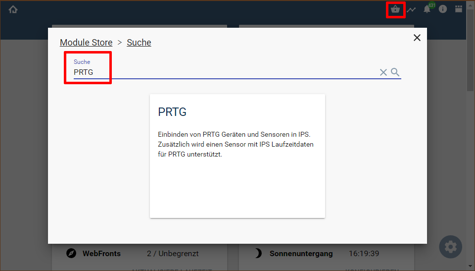

  

  
  

# Symcon-Modul: PRTG  <!-- omit in toc -->  

Einbinden von PRTG Geräten und Sensoren in Symcon und Überwachen von Symcon in PRTG.  

## Inhaltsverzeichnis <!-- omit in toc -->

- [1. Funktionsumfang](#1-funktionsumfang)
- [Vorbemerkungen](#vorbemerkungen)
  - [Zur Library](#zur-library)
  - [Zur Integration von PRTG](#zur-integration-von-prtg)
- [2. Voraussetzungen](#2-voraussetzungen)
- [3. Software-Installation](#3-software-installation)
- [4. Enthaltende Module](#4-enthaltende-module)
  - [PRTG IO](#prtg-io)
  - [PRTG Konfigurator](#prtg-konfigurator)
  - [PRTG Gerät](#prtg-gerät)
  - [PRTG Sensor](#prtg-sensor)
- [5. Anhang](#5-anhang)
  - [1. GUID der Module](#1-guid-der-module)
  - [2. Changelog](#2-changelog)
  - [3. Spenden](#3-spenden)
- [6. Lizenz](#6-lizenz)

## 1. Funktionsumfang

- Darstellen des Zustands von Geräten und Sensoren aus PRTG in Symcon, inklusive der Werte aller Kanäle eines Sensors.  
- Pausieren und Fortsetzen der Überwachung sowie Bestätigen von Alarmen aus Symcon heraus.  
- Zeitnahes Aktualisieren in Symcon, wenn PRTG eine Statusänderung meldet.  
- Bereitstellen von Systeminformationen aus Symcon für einen Sensor in PRTG.  
- Abrufen von Graphen aus PRTG.  

## Vorbemerkungen

### Zur Library

Die Library nutzt die [HTTP-API](https://www.paessler.com/manuals/prtg/http_api) von PRTG.  
Die Instanzen fragen PRTG zyklisch ab. Zusätzlich kann PRTG Statusänderungen per WebHook an Symcon melden, damit Symcon nicht bis zur nächsten Abfrage warten muss.  

### Zur Integration von PRTG

Der im [PRTG IO](PRTGIO/README.md) verwendete Benutzer sollte in PRTG administrative Rechte bekommen, um die Überwachung zu steuern und Alarme bestätigen zu können.  
Die Kommunikation zwischen Symcon und PRTG kann per HTTP oder per HTTPS (SSL/TLS) erfolgen. Hierzu ist die URL im [PRTG IO](PRTGIO/README.md) entsprechend anzupassen.  

> [!IMPORTANT]
> Bei unverschlüsselter Übertragung (HTTP) werden die Zugangsdaten im Klartext übertragen. Für einen PRTG-Server außerhalb des eigenen Netzwerks immer HTTPS verwenden.

## 2. Voraussetzungen

- Symcon ab Version 8.2  
- PRTG mit erreichbarer Weboberfläche  

## 3. Software-Installation

Über den Module Store in Symcon die Library `PRTG` hinzufügen.  
  

Die Abfrage, ob ein [Konfigurator](PRTGConfigurator/README.md) angelegt werden soll, ist zu bestätigen.  
Es wird automatisch die Konfiguration für den benötigten [IO](PRTGIO/README.md#4-einrichten-der-instanzen-in-symcon) abgefragt.  

> [!TIP]
> Zuerst den [PRTG IO](PRTGIO/README.md) erstellen und fertig konfigurieren, sowie in PRTG alle gewünschten Einstellungen vornehmen. Danach die Geräte und Sensoren über den [PRTG Konfigurator](PRTGConfigurator/README.md) anlegen.

## 4. Enthaltende Module

### [PRTG IO](PRTGIO/README.md)

- Schnittstelle zwischen den Geräte- und Sensor-Instanzen und PRTG.  
- Empfangen von Ereignissen aus PRTG über einen WebHook.  
- Bereitstellen von Systeminformationen aus Symcon für einen Sensor in PRTG.  
- Abrufen von Graphen aus PRTG.  

### [PRTG Konfigurator](PRTGConfigurator/README.md)

- Auflisten aller in PRTG verfügbaren Geräte und Sensoren.  
- Anlegen von Geräte- und Sensor-Instanzen in Symcon.  

### [PRTG Gerät](PRTGDevice/README.md)

- Darstellen des Zustands eines Gerätes und der Anzahl seiner Sensoren je Zustand.  
- Pausieren und Fortsetzen der Überwachung über die Visualisierung, Aktionen und PHP-Skripte.  

### [PRTG Sensor](PRTGSensor/README.md)

- Darstellen des Zustands eines Sensors und der Werte aller seiner Kanäle.  
- Pausieren und Fortsetzen der Überwachung über die Visualisierung, Aktionen und PHP-Skripte.  
- Bestätigen von Alarmen über die Visualisierung, Aktionen und PHP-Skripte.  

## 5. Anhang

### 1. GUID der Module

|       Modul       |     Typ      | Prefix |                  GUID                  |
| :---------------: | :----------: | :----: | :------------------------------------: |
|      PRTG IO      |     I/O      |  PRTG  | {67470842-FB5E-485B-92A2-4401E371E6FC} |
| PRTG Configurator | Configurator |  PRTG  | {32B8B831-91B2-44B5-9B66-9F1685647216} |
|    PRTG Device    |    Device    |  PRTG  | {95C47F84-8DF2-4370-90BD-3ED34C65ED7B} |
|    PRTG Sensor    |    Device    |  PRTG  | {A37FD212-2E5B-4B65-83F2-956CB5BBB2FA} |

### 2. Changelog

**Version 2.61:**  

> [!IMPORTANT]
> Neu angelegte Geräte- und Sensor-Instanzen benennen sich und ihre Kanäle nicht mehr automatisch nach den Namen in PRTG um. Das kann in der Instanzkonfiguration eingeschaltet werden. Vorhandene Instanzen behalten ihre bisherige Einstellung.  
> Sensor: Kanäle mit Zahlenwert, deren Einheit bisher nicht erkannt wurde (z.B. `°C`, `V` oder die Einheiten eines englisch eingestellten PRTG), werden als Zahl angelegt. Ist dafür bereits eine Variable vom Typ String vorhanden, meldet die Instanz den abweichenden Typ im Log und schreibt keinen Wert. Abhilfe: Variable löschen oder in der Kanalübersicht `Ignoriere Einheit und Typ` setzen.

**Geändertes Verhalten**  

- Konfigurator: Die Zusammenfassung zeigt den PRTG-Server des IO an.  
- IO: Graphen nutzen die SSL-Einstellungen der Instanz. `PRTG_GetGraph` meldet Fehler (z.B. ungültige Parameter, PRTG nicht erreichbar) an den Aufrufer.  
- IO: Passwort und Passwort-Hash werden im Debug nicht mehr angezeigt.  
- Sensor: Einheiten eines englisch eingestellten PRTG (z.B. `msec`, `kbit/s`, `Mbit/s`, `KByte`) werden erkannt.  
- Gerät und Sensor: Nach dem Start, nach Änderungen an der Instanz und beim Verbinden des IO wird nicht mehr sofort abgefragt. Neue Werte kommen mit dem nächsten Intervall oder mit einem Ereignis von PRTG. Bisher fragten dabei alle Instanzen gleichzeitig an, wodurch Symcon bei vielen Instanzen Abfragen verwarf.  

**Behobene falsche Werte in Statusvariablen**  

- Gerät und Sensor: Der Status wurde nach Änderungen an der Instanz oder nach einem Modul-Update auf `Kein Test` gesetzt.  
- Sensor: Bandbreiten ab 1 Mbit/s wurden mit der Einheit `KB` statt `Mbit/Sek.` angezeigt.  
- Sensor: Werte mit der Einheit Anzahl pro Sekunde, Anzahl pro Minute und `Items` konnten je nach PRTG-Version um den Faktor 10 falsch sein.  

**Fehlerbehebungen**  

- IO: Der WebHook lieferte keine Graphen.  
- Gerät, Sensor und Konfigurator: Eine fehlgeschlagene Anfrage an den IO führte zu einem PHP-Fehler.  
- Sensor: Mit gesetztem `Ignoriere Einheit und Typ` wurde eine vorhandene Variable mit abweichendem Typ durch eine neue ersetzt. Sie bleibt jetzt erhalten und der Wert wird in ihren Typ umgewandelt.  
- IO: Ungültige Antworten von PRTG wurden nicht als Fehler erkannt.  

**Version 2.60:**  

> [!IMPORTANT]
> Diese Version benötigt Symcon 8.2.  
> Die Variablenprofile wurden durch Darstellungen ersetzt. Speicher- und Bandbreitenwerte der Sensoren werden jetzt ohne Umrechnung als Rohwert aus PRTG (Byte bzw. Byte/s) gespeichert.

**Geändertes Verhalten**  

- Sensor: Die Einheiten aus PRTG werden zuverlässiger erkannt.  
- Sensor: Fehlende Einheiten und Kanäle, die einen anderen Variablentyp benötigen als die vorhandene Variable, werden im Log gemeldet.  
- Sensor: Die Instanzkonfiguration zeigt eine Übersicht der Kanäle mit ihren erkannten Einheiten und Variablentypen.  
- IO: Der Symcon-Sensor für PRTG liefert zusätzlich die Größe der Nachrichtenwarteschlange, die Anzahl langsamer Nachrichten sowie die durchschnittliche Laufzeit und den Speicherverbrauch der PHP-Threads.  

**Version 2.52:**  

- Version für Symcon 7.0.  

**Version 2.51:**  

- Sensor und Device Intervall konnte beim starten von Symcon falsch sein.  

**Version 2.50:**  

- Wurde ein Sensor pausiert, so wurden alle Statusvariablen neu als String angelegt und die alten somit gelöscht.  
- Aktionen hinzugefügt.  
- Dynamische Konfigurationsformulare und somit einfacher zu konfigurieren.  
- IO zeigt den Event Webhook für PRTG an.  
- Event Webhook mit verbesserten NAT Support.  
- Event Webhook unterstützt abweichenden Port (z.B. für NAT).  

**Version 2.30:**  

- Werte für Mbit/sek. und kbit/sek. waren um den Faktor 10 zu groß.  

**Version 2.20:**  

- Fehler im Symcon-Sensor behoben, wenn PRTG 'Keine Daten' als Nutzdaten übertragen hat.  

**Version 2.10:**  

- Fehler im Symcon-Sensor behoben, wenn Laufwerke keine Bezeichnung hatten  
- Fehler im Symcon-Sensor behoben, wenn Pagefile genutzt wird  

**Version 2.00:**  

- Release für Symcon 5.1 und den Module-Store  

**Version 1.36:**  

- Location Feld in create verschoben  

**Version 1.35:**  

- Fehler im Konfigurator, wenn die Kategorie in der Kategorieauswahl nicht auf oberster Ebene war.  
- Fehlende Übersetzung ergänzt.  
- Konfigurator meldet wenn IO nicht aktiv ist.  

**Version 1.31:**  

- Darstellungsfehler im Konfigurator beseitigt  
- Formen nutzen jetzt NumberSpinner mit Suffix anstatt IntervalBox  

**Version 1.30:**  

- Fehlerbehandlung Datenaustausch überarbeitet  
- Konfigurator erstellt Instanz unterhalb von Kategorien mit dem Namen des jeweiligen Gerätes  

**Version 1.20:**  

- Sensordaten eines SSL-Zertifikatssensor verursachten Fehler  

**Version 1.10:**  

- SSL Checks sind desaktivierbar  
- Sensorwerte mit Laufzeit Tage verursachten Fehler  

**Version 1.0:**  

- Erstes offizielles Release  

### 3. Spenden  
  
Die Library ist für die nicht kommerzielle Nutzung kostenlos, Schenkungen als Unterstützung für den Autor werden hier akzeptiert:  

  

  

## 6. Lizenz

Symcon-Modul:  
[Custom NC-SA](LICENSE)  
